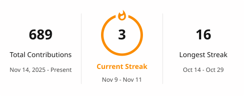
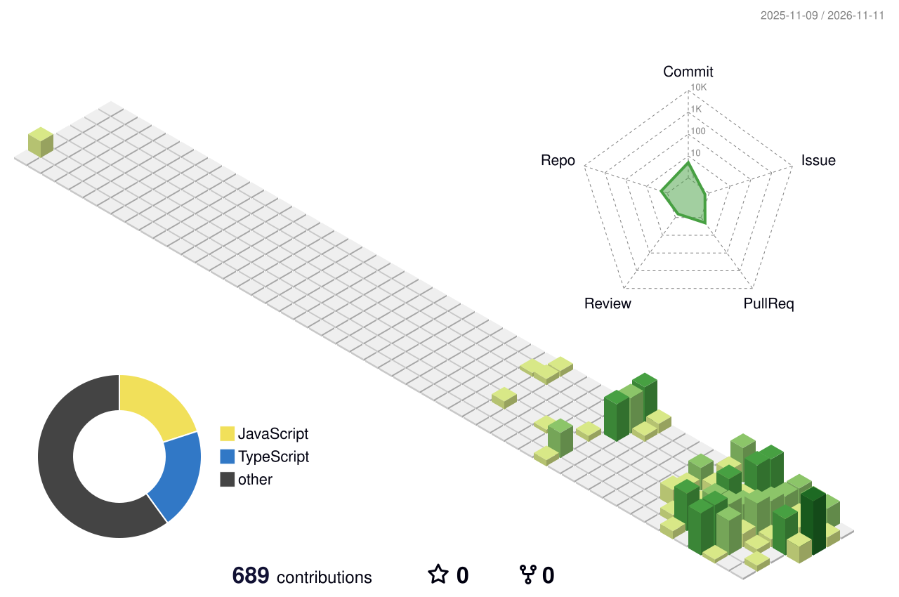

# 𝓽𝓲𝓮𝓷𝓽𝓱𝓪𝓶𝟐𝟎𝟎𝟓

### 𝓑𝓾𝓲𝓵𝓭𝓲𝓷𝓰 𝓐𝓘 𝓪𝓰𝓮𝓷𝓽𝓼, 𝓸𝓷𝓮 𝓟𝓡 𝓪𝓽 𝓪 𝓽𝓲𝓶𝓮.

##

🎯 **AI Agent · Data Platform**

🏢 Building in-house AI agents at **Lam Son Retail** (HAPAS · MATE MADE)

✉️ [tienthamnguyen6@gmail.com](mailto:tienthamnguyen6@gmail.com)

  <picture>
    <source media="(prefers-color-scheme: dark)" srcset="./profile/streak-dark.svg" />
    <source media="(prefers-color-scheme: light)" srcset="./profile/streak-light.svg" />
    
  </picture>

## Work @ Lam Son Retail

Repo private của công ty nên không có link; số liệu tính đến 2026-11-10.

| Project | Role | What it does | Stack | Activity |
| --- | --- | --- | --- | --- |
| **Mark Trần** · Social Listening Agent 🔒 | Owner | Bot Lark lắng nghe mạng xã hội cho HAPAS: thu thập FB / IG / TikTok / Threads / báo, gán nhãn sắc thái bằng AI, dashboard chỉ số, TikTok & Meta Ads, cảnh báo page lừa đảo + máy học | Python · PostgreSQL · Apify · BigQuery · Lark | 137 commits · 137 PRs merged |
| **Fina** · Finance Agent 🔒 | Owner | Tự động hoá báo cáo dòng tiền: phân loại sao kê, đồng bộ đề nghị thanh toán, gom kế hoạch dòng tiền theo brand | Python · Lark · Google Sheets | 124 commits |
| **LSR Agent Platform** 🔒 | Core contributor | Nền tảng agent nội bộ: console, cổng kết nối MCP dùng chung cho mọi agent, hạn mức, đăng ký & chấm điểm agent | Python · TypeScript · BigQuery | 80 commits · 60 PRs merged |
| **HR Agent** 🔒 | Owner | Trợ lý nhân sự trên Lark, phân quyền ai xem được tài liệu nào, chạy trên Claude Agent SDK | Python · Claude Agent SDK · Lark | 27 commits |
| **Mino** · Meeting Notes Agent 🔒 | Owner | Họp xong tự phát hiện → phiên âm Whisper → sinh recap → gửi biên bản cho người dự | Python · Whisper · Lark | 22 commits |
| **[Lark MCP v3 Remote](https://github.com/LamsonRetail/hapas-lark-remote)** | Owner | MCP server từ xa cho Lark: một URL cho cả công ty, mỗi người đăng nhập OAuth của mình | Node.js · MCP · OAuth | — |
| **[Invoice Extract Tool](https://github.com/LamsonRetail/hapas_invoice_extract_tool)** | Owner | Bóc tách hoá đơn chạy song song, đọc được cột Lookup của Base | Python · Lark Base | 7 commits |

≈ 400 commits · 199 PRs merged across 7 projects

## Open Source Contributions

<!-- OSS_CONTRIBUTIONS:START -->

<!-- One row per repository: the most representative merged PR. (+N) = N more merged PRs in that repo. Stats below count public PRs only. -->

| Status | Project | PR | Scope |
| --- | --- | --- | --- |
| 🌱 | First upstream PR in progress | — | — |

2 merged · 0 in review · 0 closed — 2 repositories, 2 PRs · updated 2026-11-11

<!-- OSS_CONTRIBUTIONS:END -->

## Featured Project

|  |  |
| --- | --- |
| **[AI Expert Hub](https://github.com/tientham2005/ai-expert-hub)** | Tin tức AI ứng dụng từ các chuyên gia hàng đầu, dịch và tóm tắt sang tiếng Việt mỗi ngày · [Live demo](https://ai-expert-hub-phi.vercel.app) |
| Stack |        |
| Highlights | Cron cào RSS / YouTube · định tuyến model theo nền tảng · tóm tắt video theo mốc thời gian · chatbot hỏi đáp theo bài |

  <picture>
    <source media="(prefers-color-scheme: dark)" srcset="./profile-3d-contrib/profile-night-rainbow.svg" />
    <source media="(prefers-color-scheme: light)" srcset="./profile-3d-contrib/profile-green-animate.svg" />
    
  </picture>

<picture>
  <source media="(prefers-color-scheme: dark)" srcset="https://raw.githubusercontent.com/tientham2005/tientham2005/output/github-contribution-grid-snake-dark.svg">
  <source media="(prefers-color-scheme: light)" srcset="https://raw.githubusercontent.com/tientham2005/tientham2005/output/github-contribution-grid-snake.svg">
  
</picture>
